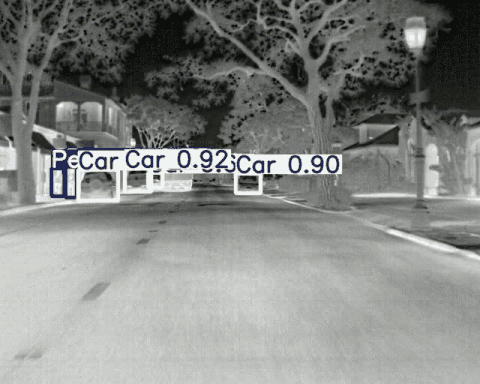
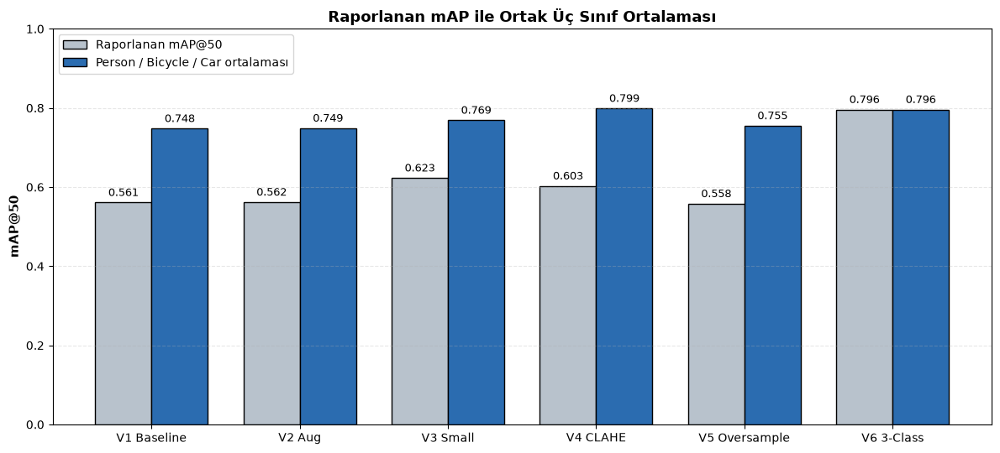
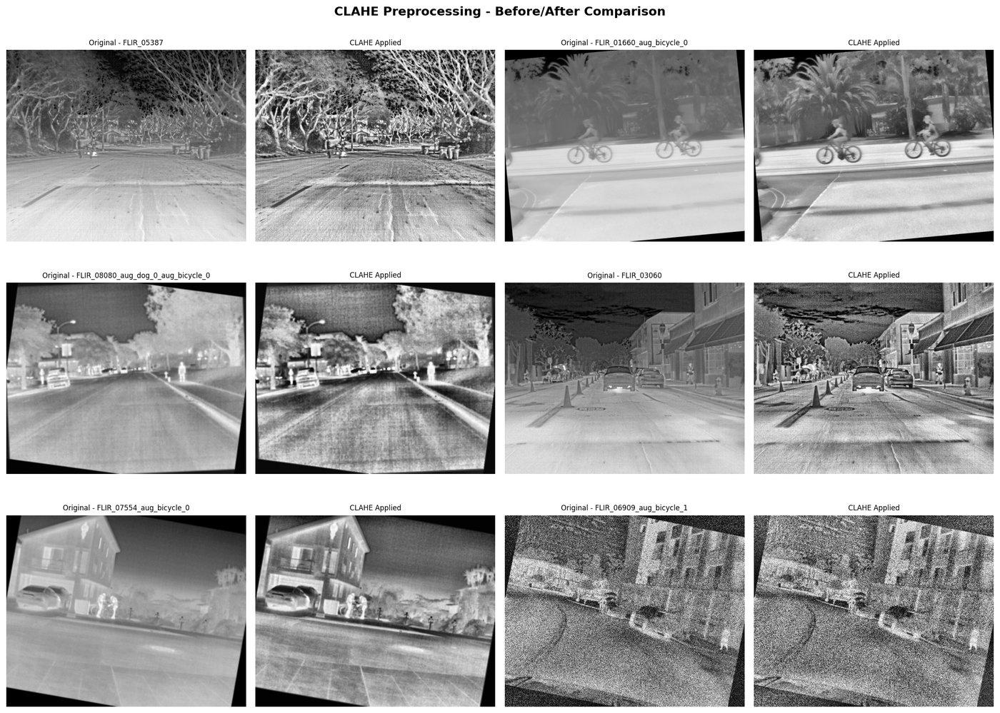
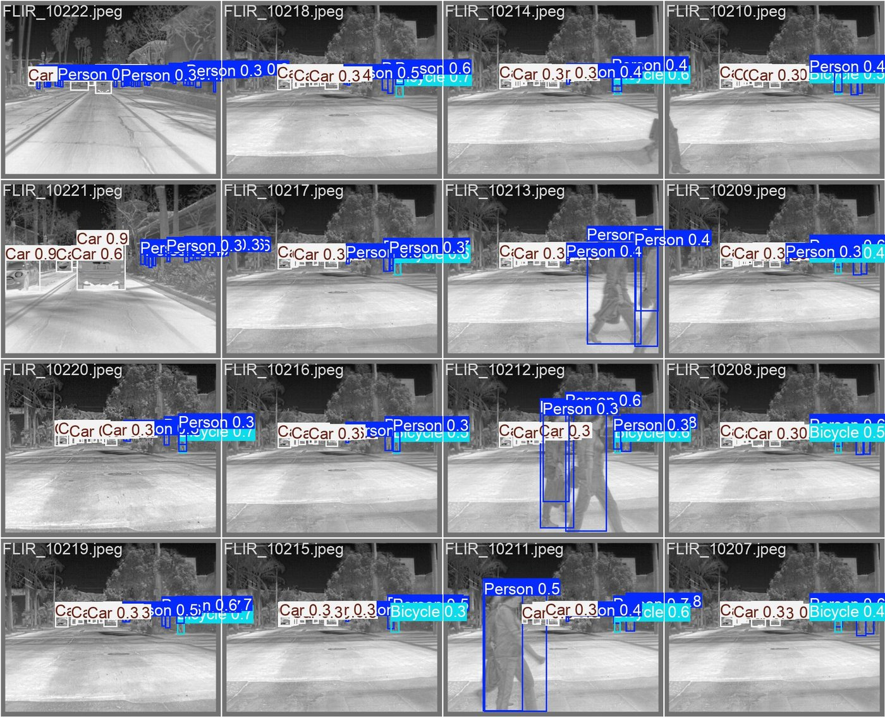
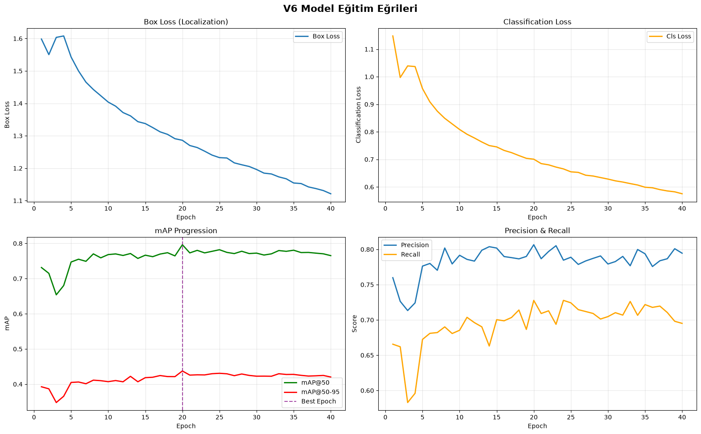
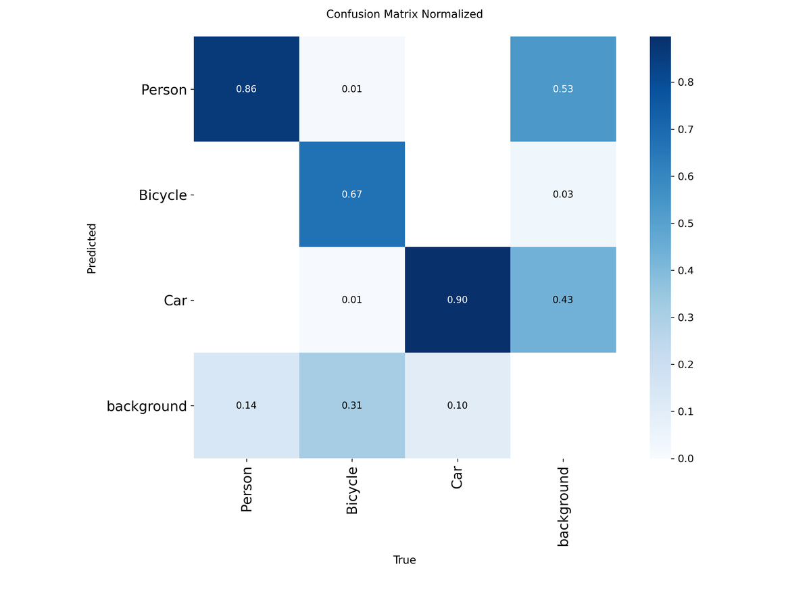
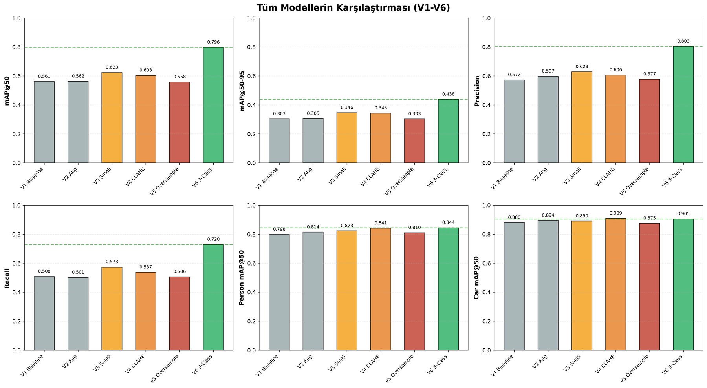

# Termal Görüntülerde Uç Cihaz Odaklı Nesne Tespiti

FLIR ADAS termal veri seti üzerinde YOLO11 ile yaya, bisiklet ve araç tespiti yapan, ardından modeli TensorRT INT8 ile hızlandıran lisans bitirme projem.



*Eğitimde hiç kullanılmamış FLIR test videosu üzerinde TensorRT INT8 modelin çıktısı (conf > 0.5).*

## Proje hakkında

Gece, sis veya karşıdan gelen far ışığı gibi durumlarda RGB kameralar yayaları ve bisikletlileri görmekte zorlanıyor. Termal kamera ise ışığa değil ısıya baktığı için bu koşullardan çok daha az etkileniyor. Bu projede iki soruya cevap aradım:

1. Termal görüntülerde person, bicycle ve car sınıflarını ne kadar iyi tespit edebiliriz?
2. Bu modeli bir araca takılabilecek bir cihazda gerçek zamanlı çalışacak kadar küçültüp hızlandırabilir miyiz?

Çalışmanın tamamı, veri analizinden quantization'a kadar tek bir notebook'ta: [`termal_nesne_tespiti.ipynb`](termal_nesne_tespiti.ipynb)

## Sonuçlar

### Final model (V6, YOLO11s, 3 sınıf)

| Sınıf | FLIR baseline (RefineDet512) | V6 FP32 | V6 TensorRT INT8 |
|---|---:|---:|---:|
| Person | 0.794 | **0.844** | 0.798 |
| Bicycle | 0.580 | **0.639** | 0.598 |
| Car | 0.856 | **0.905** | 0.885 |
| **Ortalama** | | **0.796** | 0.760 |

Değerler validation setinde mAP@50. FLIR baseline değerleri veri setinin README dosyasından alındı. Değerlendirme araçları farklı olduğu için bu karşılaştırma yaklaşık.

### Quantization

| Format | Donanım | Boyut | mAP@50 | Ort. latency | FPS |
|---|---|---:|---:|---:|---:|
| PyTorch FP32 | Tesla T4 | 18.3 MB* | 0.796 | 9.69 ms | 103 |
| **TensorRT INT8** | Tesla T4 | 12.2 MB | 0.760 | **4.37 ms** | **229** |
| ONNX FP32 | Colab CPU | 36.2 MB | 0.795 | 109.65 ms | 9.1 |
| ONNX INT8 (dynamic) | Colab CPU | 9.4 MB | 0.785 | 576.41 ms | 1.7 |

\* Ultralytics `.pt` dosyalarında ağırlıklar FP16 olarak saklanıyor. Gerçek FP32 boyutu ONNX dosyasındaki 36.2 MB.

TensorRT INT8, 0.036 puanlık mAP kaybıyla 2.2 kat hızlanma sağladı ve INT8 model bile üç sınıfta FLIR baseline'ının üzerinde kaldı. ONNX dynamic quantization ise boyutu 4 kat küçültmesine rağmen CPU'da modeli 5 kat yavaşlattı, çünkü konvolüsyon katmanlarında kullanılan `ConvInteger` operatörü CPU'da iyi optimize edilmemiş. Bu tür bir model için kalibrasyonlu static quantization daha doğru bir seçim.

## Deneyler

Her denemede tek bir şeyi değiştirdim ki farkın nereden geldiğini söyleyebileyim.

| Model | Değişiklik | mAP@50 | Ortak 3 sınıf ort. |
|---|---|---:|---:|
| V1 | YOLO11n baseline | 0.561 | 0.748 |
| V2 | + Dog ve bicycle için offline augmentation | 0.562 | 0.749 |
| V3 | YOLO11s (daha büyük model) | 0.623 | 0.769 |
| V4 | YOLO11s + CLAHE ön işleme | 0.603 | **0.799** |
| V5 | YOLO11s + dog sınıfı için 10x oversampling | 0.558 | 0.755 |
| V6 | YOLO11s, dog sınıfı çıkarıldı | **0.796** | 0.796 |



V1-V5'in mAP değeri dog dahil 4 sınıfın, V6'nınki 3 sınıfın ortalaması. Bu yüzden V6'daki büyük sıçramanın çoğu, ortalamadan sıfıra yakın bir sınıfın çıkmasından geliyor. Ortak üç sınıfa bakınca gerçek kazanç daha küçük ve CLAHE uygulanan V4, V6 ile aynı seviyede.

Öne çıkan bulgular:

- **Dog sınıfı bu veriyle öğrenilemedi.** Train'de sadece 226 etiket var. Augmentation, büyük model, CLAHE ve oversampling denedim, hiçbiri işe yaramadı. V3'teki 0.185 değeri, 14 köpekli bir validation setinde tek bir epoch'a ait istatistiksel bir dalgalanma çıktı.
- **V3'ün en iyi sonucu 1. epoch'ta geldi.** Learning rate warmup'ı 3. epoch'ta performansı geçici olarak düşürüyor ve patience=10 olduğu için model toparlanmadan durduruldu. Sonraki deneylerde patience'ı 15'e çıkardım.
- **CLAHE en etkili ön işleme oldu**, özellikle ince yapılı bisikletlerde (+0.054).
- **Oversampling ezberlemeye yol açtı.** Train loss diğer modellerin yarısına inerken validation loss yerinde saydı.

<details>
<summary>Diğer görseller</summary>

**CLAHE öncesi ve sonrası**



**V6 validation tahminleri**



**V6 eğitim eğrileri**



**V6 normalize confusion matrix**



**Tüm modellerin karşılaştırması**



</details>

## Veri seti

[FLIR Thermal Starter Dataset v1.3](https://www.flir.com/oem/adas/adas-dataset-form/). Santa Barbara'da araca monte bir FLIR Tau2 kamerayla çekilmiş 640x512 çözünürlüklü termal görüntüler.

| Split | Görüntü | Etiket |
|---|---:|---:|
| Train | 8,862 | 67,844 |
| Val | 1,366 | 11,693 |
| Video | 4,224 | |

Etiketlerin %60.8'i car, %33.0'ı person, %5.9'u bicycle ve %0.3'ü dog. Kutuların %58.3'ü COCO tanımına göre küçük nesne (32x32 pikselden küçük).

Veri seti lisans gereği bu repoda yok. Kendi bilgisayarınızda çalıştırmak için FLIR'ın sitesinden indirip `data/` klasörüne çıkarmanız ve `configs/` içindeki yaml dosyalarında `path` satırını güncellemeniz gerekiyor.

## Repo yapısı

```
├── termal_nesne_tespiti.ipynb   # Tüm çalışma: analiz, eğitim, quantization, video
├── configs/                      # Her deneyin data.yaml dosyası
├── results/
│   ├── model_comparison.csv      # V1-V6 özet tablo
│   └── <deney>/                  # Her deneyin results.csv ve args.yaml dosyası
├── weights/
│   ├── v6_yolo11s_3class.pt                  # Final model
│   └── v6_yolo11s_3class_int8_dynamic.onnx   # ONNX dynamic INT8
└── assets/                       # README görselleri
```

TensorRT engine dosyası GPU'ya ve TensorRT sürümüne özel olduğu için repoya eklenmedi. Aşağıdaki komutla kendi ortamınızda üretebilirsiniz.

## Kullanım

```bash
pip install -r requirements.txt
```

Tek bir görüntü veya video üzerinde çıkarım:

```python
from ultralytics import YOLO

model = YOLO("weights/v6_yolo11s_3class.pt")
model.predict("termal_goruntu.jpeg", conf=0.5, save=True)
```

TensorRT INT8'e çevirmek için (NVIDIA GPU gerekli):

```python
model = YOLO("weights/v6_yolo11s_3class.pt")
model.export(format="engine", int8=True, data="configs/thermal_3class.yaml")
```

Notebook Google Colab'da (Tesla T4) çalıştırıldı ve yollar `/content/drive/MyDrive/tez/` altında tanımlı.

## Sınırlılıklar

- FLIR'ın etiketli ayrı bir test seti yok. Model seçimi ve raporlama aynı validation seti üzerinden yapıldığı için sonuçlar hafif iyimser olabilir. INT8 kalibrasyonu da aynı setle yapıldı.
- Her deney tek seed ile koşuldu. Modeller arasındaki 1-2 puanlık farkların bir kısmı rastlantısal olabilir.
- Ölçümler gerçek bir uç cihazda değil, Colab T4 ve Colab CPU üzerinde yapıldı.

## Sonraki adımlar

- CLAHE ile 3 sınıflı veriyi birleştirmek (V4 + V6)
- TensorRT FP16 ve mixed precision INT8 ile doğruluk kaybını azaltmak
- ONNX için kalibrasyonlu static quantization (QDQ)
- Jetson Orin Nano üzerinde gerçek cihaz testi

## İletişim

Feritcan Obuz · [LinkedIn](https://www.linkedin.com/in/feritcan-obuz/) · [GitHub](https://github.com/feritcanobuz)

Eskişehir Osmangazi Üniversitesi, İstatistik Bölümü, 2026
